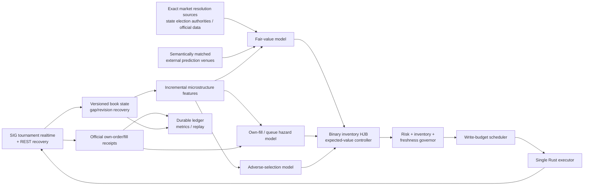
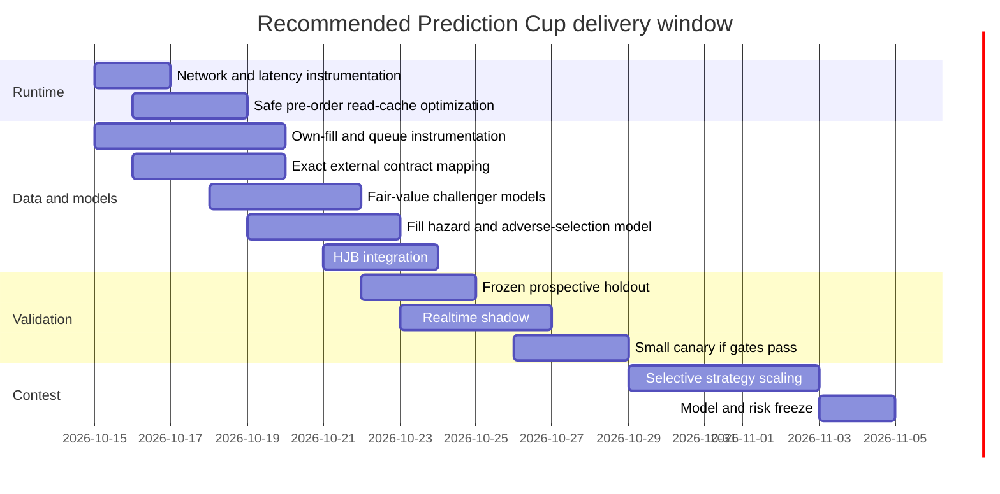

# Moloch vs Main: Quantitative Audit and Low-Latency Roadmap for the SIG Prediction Cup

## Executive summary

The most important repository finding is that **`codex/moloch` is no longer a genuinely competing branch to `main`**. The repository’s current comparison shows `main` is **309 commits ahead of `codex/moloch` and contains the Moloch branch history**; the branch head is `137b07b...`, while the October 15 main takeover reached `342c38e...`. The latest execution log in issue #120 says the takeover to `main` was completed, the all-market path had generated four funded internal proposals but had not made a physical order attempt, and the corrected V8 runtime was running as of the 08:09 UTC update. No Moloch profit was claimed. [GitHub branch comparison](https://github.com/GodlyDonuts/predictions-cup-2026/compare/codex/moloch...main). fileciteturn49file0L1-L2

That changes the strategic question. The right choice is **not “Moloch or main?”** It is: **which ideas from the original Moloch research are worth retaining inside the much stronger current `main` production/research stack?** Current main has already absorbed the right Moloch pieces—native Rust, official realtime data, durable order-intent accounting, version/gap recovery, actual-fill accounting—and added whole-tournament discovery, richer causal studies, an inventory-aware binary HJB framework, prospective holdouts, and significantly stronger execution safeguards. The current `main` Moloch README explicitly says the Rust live runtime is now the production entry point and the JavaScript engine is an offline research/reference implementation. fileciteturn33file0L1-L7

The uncomfortable but useful quantitative conclusion is that **the repository has considerably more engineering maturity than demonstrated alpha**. The old Moloch strategy comparison found tiny positive paper results under some configurations—paired-spread without the current-flow gate produced two simulated fills and +0.015 SUSQies; microprice without the gate produced three and +0.010—but the experiment explicitly lacked an untouched holdout. A larger Moloch VPS paper audit later ended with **−150.280 SUSQies**, 151 orders, 60 counterfactual fills and no profitability claim. The adverse-selection classifier failed out of sample. Current-main research is more rigorous, but it still reports “no profitable policy selected”: the latest ridge book model obtained only small forecast improvements at longer horizons and generated **zero executable quote signals**, the same-market YES/NO complement study found **zero positive simultaneous arbitrages over 76,189 accepted book points**, and the cross-venue study correctly refused to trade because settlement semantics were not proven equivalent. fileciteturn20file0L1-L6 fileciteturn22file0L1-L6 fileciteturn38file0L1-L2 fileciteturn39file0L1-L7 fileciteturn41file0L1-L7 fileciteturn40file0L1-L7

**The leap forward should therefore be execution-economic rather than model-complexity-driven.** Current main already contains an excellent research skeleton for this: its binary HJB requires a fill-intensity model calibrated from **actual own-fill receipts**, at least 32 independent calibration clusters, a chronological transition model frozen before evaluation, and inventory/risk penalties. That is exactly the direction I recommend. The missing chain is:

**independent fair value → own queue/fill hazard → adverse-selection estimate → inventory-aware HJB → write-budget-aware execution**. fileciteturn43file0L1-L7 fileciteturn44file0L1-L7

The biggest conceptual correction is to stop thinking of the Prediction Cup as conventional microsecond HFT. SIG currently sends tournament market updates in **one-second batches**; REST books may themselves be up to **one second old**; ordinary accounts share **100 reads and 30 writes per minute**, while DMM accounts get 600/200. Faster polling does not produce fresher data. Thus microsecond GPU inference, kernel-bypass networking and exotic FPGA-like engineering cannot create a microsecond information advantage against a feed whose observable state changes on approximately one-second boundaries. The practical contest is **low-latency event-driven market making and information trading under scarce API writes**, where p99 network latency, stale-state handling, quote selection and fill/adverse-selection economics dominate local arithmetic. citeturn18search1turn22search0turn22search2

That makes the **Jetson Orin Nano entirely viable as the 24/7 live executor**, provided its wired network path is stable. NVIDIA’s Orin Nano Super reference configuration has a six-core Cortex-A78AE CPU up to 1.7 GHz, 8 GB LPDDR5 with 102 GB/s bandwidth, 1,024 CUDA cores, Gigabit Ethernet and PCIe 3.0 x4 NVMe capability. The GPU is valuable for offline/batched experimentation but is unnecessary in the sub-millisecond live decision loop: a tiny logistic, ridge or small tree model compiled into Rust will be vastly below the server/feed latency floor. Use the **RTX 3070 Ti/i9/32 GB laptop as the primary trainer/backtester and a cold or warm standby**, unless actual wired RTT/jitter measurements prove that the laptop has the materially superior network path. Never allow both machines to write against the contest account simultaneously. citeturn18search5turn18search6

The highest-priority engineering optimization is surprisingly not GPU work. Current `main`’s live `worker.rs` still performs multiple serialized authenticated REST reads in `snapshots()` before authorizing a physical order—account, positions, open orders, market, contract and book—while the transport intentionally uses 600 ms read pacing. That design is extremely safe, but it can consume seconds of pre-dispatch wall-clock time and scarce read budget. The largest latency gain will come from **proving which immutable/static and versioned/fresh facts can safely be cached**, leaving a minimal final authorization fence rather than rebuilding the world before every quote. This optimization must preserve Moloch’s excellent fail-closed semantics for ambiguous acceptance, account reconciliation and freshness. fileciteturn47file0L1-L2 fileciteturn35file0L1-L7

My recommended target architecture is:

The key idea is simple: **optimize expected final SUSQie balance, not trades per second**. SIG’s final ranking is determined by final SUSQie balance after settlement, and the competition runs through November 4, 2026 at noon Eastern. High turnover that merely crosses a 0.005 spread or creates adverse inventory is actively harmful. citeturn18search0turn22search13

## Repository audit and branch comparison

The original `codex/moloch` work is valuable because it established conservative event semantics, fill modeling, inventory accounting and the first native Rust path. Its JavaScript policy defaults to 1,000 simulated SUSQies, 40 committed, 10 per market, four markets, five-share quotes, 3,000 ms modeled latency, 120-second lifetime, 10-second book freshness, 1% observed-volume participation, 24 writes/minute and a `strictThrough` fill model. It supports paired-spread, microprice and cheap-spread modes, inventory aging and protected exits. fileciteturn36file0L1-L7

The original microprice is fundamentally a **top-of-book imbalance heuristic**, not a trained probability model. Moloch computes the weighted quote from best bid/ask quantities and uses spread/activity/capital considerations for candidate ranking. Its `entry-flow.mjs` adds a stronger gate requiring compatible recent two-sided trade evidence rather than blindly interpreting book imbalance as alpha. fileciteturn25file0L1-L6

The branch did attempt model training. `adverse-model.mjs` builds book-state features and fits a regularized logistic model on chronologically separated samples to estimate adverse post-fill moves. That is conceptually sound, but the stored result rejected the model: its holdout Brier score was worse than the holdout baseline, and the supposedly low-risk subset was actually more adverse than the overall test population. That rejection is a strength of the research process—it prevented an in-sample-looking model from becoming execution policy. fileciteturn21file0L1-L6 fileciteturn22file0L1-L6

Current `main` is substantially beyond that state. Its production README describes one Rust live runtime, native strategy/ledger, a serialized official transport, idempotent durable dispatch, exact official fill accounting and fail-closed handling of stream gaps and ambiguous writes. The current universe code can observe all tournament markets over the broadcast stream, exclude markets with foreign/inherited inventory, rank markets by fresh recent activity and bounded turnover characteristics, and retain owned obligations ahead of discovery. fileciteturn35file0L1-L7 fileciteturn48file0L1-L7

### Branch diff and key files

| Area | `codex/moloch` snapshot | Current `main` | Assessment / key files |
|---|---|---|---|
| Branch relationship | Ancestor at `137b07b...` | 309 commits beyond that snapshot at the researched head; latest takeover log names `342c38e...` | Treat main as the successor, not a competing strategy. [Compare](https://github.com/GodlyDonuts/predictions-cup-2026/compare/codex/moloch...main). fileciteturn49file0L1-L2 |
| Core strategy | Paired-spread maker; microprice; cheap-spread; current-flow gating; inventory exits | Retains Moloch mechanics but surrounds them with all-market discovery and a much larger research bank | [branch `engine.mjs`](https://github.com/GodlyDonuts/predictions-cup-2026/blob/codex/moloch/moloch/engine.mjs), [main Moloch README](https://github.com/GodlyDonuts/predictions-cup-2026/blob/main/moloch/README.md). fileciteturn36file0L1-L7 fileciteturn33file0L1-L7 |
| Data pipeline | NDJSON/book/trade/gap/coverage events; paper engine and native replay; selected-market capture | Tournament-wide realtime channel, versioned book recovery, REST resync, broadcast breadth recording and all-market universe | [live runtime](https://github.com/GodlyDonuts/predictions-cup-2026/tree/main/moloch/live-runtime), [universe.rs](https://github.com/GodlyDonuts/predictions-cup-2026/blob/main/moloch/live-runtime/src/universe.rs). fileciteturn35file0L1-L7 fileciteturn48file0L1-L7 |
| Model training | Logistic adverse-selection model; hand-coded microprice | Ridge book-alpha studies, cross-market studies, external-venue studies, binary HJB research, inventory quote optimizer | [HJB](https://github.com/GodlyDonuts/predictions-cup-2026/blob/main/research/binary-market-maker-hjb-v1.mjs), [inventory maker](https://github.com/GodlyDonuts/predictions-cup-2026/blob/main/research/binary-inventory-maker-v1.mjs). fileciteturn43file0L1-L7 fileciteturn44file0L1-L7 |
| Backtesting | Conservative counterfactual fills, later print, minimum activation delay, participation limit | Much stronger sealed-prefix/future-holdout studies, source hashing, latency assumptions and explicit censoring | Current book-alpha study uses a sealed ~325 MB prefix covering ~290 hours and tens of thousands of held-out labels. fileciteturn39file0L1-L7 |
| Fill modeling | `strictThrough`; queue/depth approximations; public-print-derived paper fills | Production wallet credits only official owned fills; HJB refuses activation without validated own-fill calibration | This is a major methodological improvement. fileciteturn35file0L1-L7 fileciteturn43file0L1-L7 |
| Risk | Max commitment/market count, owned inventory protection, no double-pledging | Adds exact account/cash reconciliation, physical-intent durability, unknown-acceptance stop, inherited-inventory isolation, immutable funded policy | Preserve all of these. fileciteturn35file0L1-L7 |
| Execution | Initially paper; branch later grew native live execution over official API | Rust production entry point, one serialized account transport, idempotency, all-market discovery, one physical order/pass | [worker.rs](https://github.com/GodlyDonuts/predictions-cup-2026/blob/main/moloch/live-runtime/src/worker.rs). fileciteturn47file0L1-L2 |
| Deployment | Branch deployment progressed through native v4 with selected scopes | Main takeover added all-market runtime; latest issue #120 update reported V8 corrected build running, no actual Moloch profit | Status is **as-of 08:09 UTC October 15**, not a claim about its state at the moment this report is read. fileciteturn49file0L1-L2 |
| Profit evidence | Small retrospective paper wins in narrow runs; larger VPS paper run −150.280 | Current-main quant state still says “no profitable policy selected” | Do not scale based on either branch’s paper P&L. fileciteturn20file0L1-L6 fileciteturn38file0L1-L2 |

The old Moloch strategy comparison is especially informative. Removing the `currentFlow` gate increased fills and produced tiny positive paper P&L, while enabling that gate produced essentially no trading. This does **not** mean the gate should simply be removed. It means the gate is too coarse: the correct replacement is a calibrated probability of fill and adverse move, not a binary “flow-ready/not-ready” rule. The old experiment itself states that no untouched holdout was available. fileciteturn18file0 fileciteturn19file0

Current main’s research confirms that naive alternatives are not the answer. The frozen book-alpha study tested 30-, 120- and 300-second horizons. At 30 seconds the ridge model was slightly worse than unchanged bid; at 120 and 300 seconds it improved RMSE by roughly 0.9% and 1.6%, respectively, but generated **zero quotes passing the minimum executable-edge requirement**. In other words, predicting prices marginally better is not enough when the economic threshold is the spread plus execution uncertainty. fileciteturn39file0L1-L7

Likewise, the complement-arbitrage experiment is unusually decisive: over 76,189 valid snapshots from 237 contracts, the simultaneous top-pair net averaged approximately −0.006 SUSQies/share and was never positive. Sequential variants also lost roughly one spread. That should kill the idea of spending engineering time on “buy YES + buy NO below one” unless a genuinely asynchronous stale-price condition can be demonstrated with executable fills; the ordinary book algebra already enforces the complement relation. fileciteturn41file0L1-L7 SIG’s own documentation confirms that YES and NO are complementary and a YES+NO pair pays exactly one SUSQie. citeturn22search1

The current main HJB code is therefore the strongest route already present in the repo. It explicitly combines a binary probability state, inventory, running variance, terminal inventory risk, fill intensity and quote-specific immediate edge. Crucially, it refuses to regard a fill model as validated unless it is calibrated from own-fill receipts with at least 32 independent clusters and a pre-evaluation cutoff. That gate should be retained rather than bypassed. fileciteturn43file0L1-L7

## Runtime and low-latency engineering

### What “HFT” means on this venue

SIG currently exposes live tournament changes in **one-second realtime batches**; its October 2 API update says REST market data may be up to two seconds old and order books up to one second old, explicitly warning that faster polling only consumes rate limit. Realtime batches that cannot be delivered promptly are dropped, with revision gaps requiring a REST resynchronization. Ordinary accounts receive 100 reads and 30 writes/minute, shared across all keys; DMM accounts receive 600/200. citeturn22search0turn22search2

This means the relevant latency budget is approximately:

\[
T_{\text{signal→order}}
=
T_{\text{feed delivery}}
+
T_{\text{decode}}
+
T_{\text{features}}
+
T_{\text{model}}
+
T_{\text{risk}}
+
T_{\text{write queue}}
+
T_{\text{network/API}}
\]

For Moloch, the first, sixth and seventh terms can easily dwarf the model term. A 20–100 µs versus 500 µs classifier has almost no economic significance if information arrives in one-second batches or a pre-order validation sequence requires multiple rate-limited HTTP requests. This is an inference from SIG’s official feed/rate architecture and the repository’s transport design. citeturn22search0 fileciteturn47file0L1-L2

The current write limit also changes optimal execution. The repository deliberately runs at **24 writes/minute and 2.5-second write pacing**, leaving headroom under SIG’s normal 30-write cap. That conservative reserve is valuable for cancellations and recovery; I would not automatically increase to 30/minute. The goal should be to make each write higher expected value. fileciteturn34file0L1-L2 citeturn18search1

### Hardware comparison

| Property | Jetson Orin Nano VPS | User-specified RTX 3070 Ti / Core i9 / 32 GB DDR5 laptop | Quant implication |
|---|---|---|---|
| CPU | Orin Nano Super reference: six Cortex-A78AE cores, up to 1.7 GHz. citeturn18search6 | Exact i9 generation unspecified | Laptop almost certainly has much more raw single-/multi-core training headroom, but exact advantage cannot be quantified without model number |
| RAM | 8 GB LPDDR5, 102 GB/s on Super configuration. citeturn18search6 | 32 GB DDR5, per user | Laptop much better for large replay datasets and model development |
| GPU | 1,024 CUDA / 32 Tensor cores; 67 sparse INT8 TOPS on Super. citeturn18search6 | RTX 3070 Ti, per user | Either is overkill for live logistic/ridge/tree inference; laptop is preferable for training deep models |
| Storage | microSD available; M.2 2280 PCIe 3.0 x4 and 2230 x2 NVMe supported. citeturn18search5turn18search7 | Unknown | Put Jetson runtime/journal/capture on NVMe, not microSD |
| Network | Integrated Gigabit Ethernet. citeturn18search5 | NIC/Wi-Fi unspecified | **Actual wired RTT and p99 jitter decide live winner**, not GPU |
| Power / uptime | 7/15/25 W modes on Super; designed as embedded hardware. citeturn18search6 | Consumer laptop, thermal/power settings unknown | Jetson is attractive as always-on executor; laptop needs sleep disabled, AC and preferably UPS |
| Best role | Primary collector/executor, assuming lower or comparable network jitter | Training, massive replay, shadow system, standby | Recommended split |
| Biggest bottleneck | Network/API/read serialization, not CPU | Same if used for live | Hardware upgrade alone will not create alpha |

For the Jetson, use an appropriate high-performance `nvpmodel` configuration with adequate active cooling; NVIDIA documents selectable power/performance modes through `nvpmodel`. Put all large capture files and journals on NVMe. Use the physical Gigabit Ethernet interface, not Wi-Fi. Profile before and after tuning with Linux `perf`/`perf sched` and NVIDIA Nsight Systems rather than assuming CPU frequency is the bottleneck; both tools expose scheduler/system-wide latency behavior and Nsight explicitly supports Jetson. citeturn24search7turn24search1turn24search4turn24search10

I would configure the live Jetson as a stripped-down service host: no desktop workload during production, no model training, no compression on the decision thread, CPU affinity for realtime ingestion and strategy execution, dedicated persistence/network-processing workers, bounded memory pools, NVMe capture, and carefully measured interrupt/scheduler jitter. CPU isolation/affinity and any elevated scheduling policy should be introduced only after measuring the scheduler because poorly configured real-time scheduling can starve the networking or persistence threads.

The laptop should run expensive walk-forward studies, bootstraps and deep-model experiments. Its GPU becomes useful for neural sequence models and large hyperparameter sweeps, but **do not make live trading dependent on CUDA**. A GPU kernel launch, host/device synchronization or Python runtime is unnecessary when the chosen online model should have tens of features and a few hundred arithmetic operations.

### Concrete code-level optimization targets

The highest-value optimization is in the current [live `worker.rs`](https://github.com/GodlyDonuts/predictions-cup-2026/blob/main/moloch/live-runtime/src/worker.rs). Before an order, `snapshots()` obtains tournament/account information, positions, open orders, market data, contract data and a fresh order book through the serialized transport. This protects correctness, but those reads compete with the 100-read/minute account budget and are paced at 600 ms. The immediate project should be to establish which facts are **immutable, slowly changing, versioned or independently tracked** and can therefore be cached safely, leaving a much smaller final pre-order fence. fileciteturn47file0L1-L2

A useful target is:

**today:** `candidate → six-ish serialized validations → risk authority → POST`

**desired:** `candidate → O(1) cached state check + one minimal fresh account/book fence where required → risk authority → POST`

This must be proven equivalent under crash/restart, stale-data, inherited-position and unknown-acceptance cases before deployment. Do **not** remove the durable intent-before-write journal or replace ambiguous writes automatically; those are among the codebase’s strongest properties. fileciteturn35file0L1-L7

Second, remove allocation and repeated collection scans from hot paths. The JavaScript research engine repeatedly filters all unresolved orders and fills, computes pledged/opposite positions through repeated array scans and iterates/sorts the whole candidate universe. That is acceptable for research but should not return to production. Maintain indexed Rust state: `active_orders[exchange][side][action]`, running reserved cash, FIFO basis/inventory quantities, last fill by exchange/side, and a dirty-market queue. fileciteturn36file0L1-L7

Third, replace full-history feature calculations with incremental state. Maintain fixed-capacity ring buffers per active market for trade imbalance, book imbalance, returns and volatility; update exponentially weighted statistics on each valid batch. Parse prices into integer ticks exactly once at ingestion. The execution path should never allocate a DataFrame, dynamically build feature names or rescan minutes of history.

Fourth, optimize universe discovery incrementally. Current `Universe::select()` constructs, filters and sorts candidate arrays. With only 237 markets this is not remotely the dominant bottleneck, but a dirty-market score map or heap makes the architecture scale cleanly and reduces jitter. More importantly, discovery should remain asynchronous to owned-order reconciliation, which the code already prioritizes. fileciteturn48file0L1-L7

Fifth, separate the Rust process conceptually into four paths: realtime decoder/book state; strategy/features; account/write scheduler; persistence/telemetry. Critical intent journaling remains synchronous before a write, but bulk public-feed recording can be buffered to a persistence thread. The existing live-runtime design already distinguishes broadcast recording from trading authority, so this is an evolution rather than a rewrite. fileciteturn35file0L1-L7

The profiling dashboard should record **p50/p95/p99/p99.9** for websocket arrival→decode, decode→features, features→strategy decision, decision→risk completion, risk→HTTP request start, POST→acknowledgment, cancellation→confirmation, REST recovery and durable intent `fsync`. Also record scheduler delay, RSS, CPU/core utilization, NVMe write latency, websocket gaps and read/write queue waiting time. Optimize the largest p99 component first.

## Strategy research and recommended quant stack

The market-microstructure literature strongly supports using book imbalance and flow, but not as unconditional trading rules. Stoikov’s microprice adjusts midpoint using spread and imbalance and empirically improves short-horizon price estimates; Cont, Kukanov and Stoikov show short-horizon price changes relate strongly to order-flow imbalance, with impact depending on depth; Gould and Bonart find queue imbalance statistically predictive of the next mid-price move. These are exactly the families of features Moloch should retain. citeturn19search0turn19search1turn19academia8

The appropriate market-maker control framework is also already known. Avellaneda–Stoikov formalizes the trade-off between spread capture, fill arrivals and inventory risk. Current main’s binary HJB is a more appropriate contest-specific implementation because binary probabilities have finite [0,1] boundaries and terminal settlement risk; its terminal penalty scales with inventory and \(p(1-p)\), and its quote selection uses expected fill intensity and continuation value. citeturn19search7 fileciteturn43file0L1-L7

For simulation, the queue-reactive literature is more applicable than simple “trade touched my quote, therefore I filled” logic. Huang, Lehalle and Rosenbaum model the book as a state-dependent queuing system and explicitly motivate it as a transaction-cost and strategy simulator; later queue-reactive Hawkes work adds dependence on recent event flow. Those models should inspire Moloch’s fill simulator, but SIG’s one-second batch feed means the implementation must not pretend to observe individual additions and cancellations that the feed does not expose. citeturn20academia6turn20academia7

DeepLOB is worth keeping as an *offline challenger*, not the production centerpiece. Its convolutional/LSTM architecture was developed for rich high-frequency equity books and performs well on those datasets, but Moloch currently has far more severe problems—limited independent executable labels, one-second batching, settlement-specific information, rate-limited execution and unresolved fill hazard. A 40-feature linear/tree model with valid causal labels is presently more valuable than a neural network trained on correlated snapshots. citeturn20search2

Prediction-market research also argues for treating external prices as informative priors rather than truth. Wolfers and Zitzewitz show prediction markets can aggregate dispersed information effectively, but contract design matters. The repository’s own Delaware cross-venue audit demonstrates exactly why: similar-sounding questions can differ in affiliation, nomination, tie or settlement rules enough to reverse a payout in edge cases. citeturn20search3 fileciteturn40file0L1-L7

### Recommended strategy stack

| Strategy | Expected role | Current repo evidence | Recommendation |
|---|---|---|---|
| Inventory-aware passive market making | Core | Existing Moloch quoting + current HJB skeleton, but no calibrated own-fill model | **Highest priority** once fill hazard is learned |
| Book imbalance / microprice | Feature, not stand-alone strategy | Old microprice paper results weak/non-robust; literature supports predictive content | Keep as feature in fair-value/adverse models |
| Multi-level order-flow imbalance | Short-horizon state feature | Strong microstructure rationale; repository has relevant studies | Implement incrementally from successive valid snapshots |
| Queue/fill hazard | Execution model | **Missing key ingredient**; current HJB explicitly requires own-fill calibration | **Highest-value new model** |
| Conditional adverse selection | Quote veto / edge haircut | Old logistic model failed OOS | Rebuild using actual fills and richer causal features |
| External-venue lead/lag | Independent fair value | Repo blocked first test on semantic mismatch | High upside only after machine-checked settlement equivalence |
| Official-result/event trading | Directional high-edge trades near material events | Contest contracts are election related and specify resolution sources | Very high potential around result-reporting events, subject to permitted feeds |
| Cross-market relative value | Fair-value consistency / portfolio risk | Main contains cross-market studies; ordinary complement arb failed | Use probabilistic constraints and correlation, not mechanical “arb” |
| YES/NO complement arb | None under synchronized books | 0 positive observations in 76,189 snapshots | Stop spending research time here |
| DeepLOB / transformer | Challenger model | No repo evidence that data/label quality justifies it | Low priority until dataset grows |
| HJB inventory control | Final quote optimizer | Already implemented research-only | Promote after fair-value + fill models pass gates |

The live stack should have **three learned probabilities plus one control layer**.

**Fair-value model.** Estimate \(p^\*\), the conditional probability/value of the YES contract. Inputs should include SIG microprice and multi-level depth imbalance, recent returns, snapshot OFI, trade imbalance/intensity, volatility, exact semantically matched external prices, official polling/election data where relevant, time to settlement/poll closing and cross-market state. Train this on future executable mid/bid/ask outcomes for short-horizon quoting and on settlement outcomes for longer-term directional value. These are distinct labels and should not be conflated.

**Fill-hazard model.** Estimate:

\[
\lambda_{\text{fill}}
=
f(
\text{price distance},
\text{queue ahead},
\text{same-price depth},
\text{spread},
\text{recent trade flow},
\text{book imbalance},
\text{quote age},
\text{market activity},
\text{latency}
)
\]

Use actual owned orders/fills. A discrete-time hazard/logistic model is preferable initially because it is auditable, very cheap to evaluate and naturally predicts probability of fill within the next server batch. Current main’s HJB already demands this calibration concept. fileciteturn43file0L1-L7

**Adverse-selection model.** Estimate expected post-fill markout conditional on being filled rather than unconditional future price movement:

\[
A(x) = E[p_{t+h}-p_{\text{fill}}\mid\text{our quote filled},x].
\]

This distinction matters because passive orders disproportionately fill when counterparties know more or price is about to move through the quote. Cont et al. explicitly connect order-flow imbalance with adverse selection in limit-order execution. citeturn19search1

**HJB/control layer.** For each candidate quote \(q\), optimize something closer to

\[
EV(q)
\approx
P(\text{fill}\mid q,x)
\left[
\text{fair-value edge}
-\text{expected adverse markout}
+\Delta V_{\text{inventory}}
\right]
-\text{write opportunity cost}.
\]

The last term is particularly important here. A cancel/replace consumes one of only tens of writes per minute. “Queue improvement” that would be worthwhile on NASDAQ may be inferior to saving that API write for a high-information election move. SIG’s per-account rate budget makes writes a scarce resource. citeturn18search1

### Execution policy

Passive limit orders should be the default. Join the best price when net expected value is positive. Improve by one tick only when the modeled increase in fill probability multiplied by expected per-fill value exceeds both the lost spread and the shadow cost of a write. Cancel when fair value crosses the quote, adverse-selection probability spikes, the quote becomes stale, or the inventory controller requires it—not simply because a fixed timer expired.

Marketable execution should be reserved for **high-confidence, time-sensitive information shocks** where:

\[
|\hat p^\* - p_{\text{executable}}|
>
\text{spread/slippage buffer}
+
\text{model uncertainty}
+
\text{inventory penalty}.
\]

SIG officially supports market and limit orders, and a market order sweeps available liquidity; therefore execution cost must use the full visible depth rather than top-of-book alone. citeturn22search1

For inventory, current main’s HJB idea is superior to hard symmetric quotes. If long YES, reduce the aggressiveness of additional YES bids and increase the attractiveness of selling YES/buying NO. Near settlement, inventory penalties should increase dramatically for contracts where independent fair value is uncertain. Binary claims are especially nonlinear around \(p=0.5\), which current HJB code acknowledges through its \(p(1-p)\)-scaled terminal risk. fileciteturn43file0L1-L7

A critical contest-specific edge is **information release timing**, not just book state. The final weeks should classify markets into election/race clusters and attach event clocks: poll releases, official election-result reporting, poll closing, recount/runoff status and other exact resolution-relevant updates. The rules say each market’s Info tab identifies the rules and data source that determines settlement; those exact sources should take precedence over generic news. citeturn18search0

Key research links:

- Stoikov, *The Micro-Price*: https://papers.ssrn.com/sol3/papers.cfm?abstract_id=2970694 citeturn19search0
- Cont, Kukanov & Stoikov, *The Price Impact of Order Book Events*: https://papers.ssrn.com/sol3/papers.cfm?abstract_id=1712822 citeturn19search1
- Avellaneda & Stoikov, *High-frequency trading in a limit order book*: https://math.nyu.edu/inmemoriam/avellaneda/HighFrequencyTrading.pdf citeturn19search7
- Gould & Bonart, *Queue Imbalance as a One-Tick-Ahead Price Predictor*: https://arxiv.org/abs/1512.03492 citeturn19academia8
- Huang, Lehalle & Rosenbaum, *Queue-Reactive Model*: https://arxiv.org/abs/1312.0563 citeturn20academia6
- Wu et al., *Queue-reactive Hawkes Models*: https://arxiv.org/abs/1901.08938 citeturn20academia7
- Zhang, Zohren & Roberts, *DeepLOB*: https://arxiv.org/abs/1808.03668 citeturn20search2
- Wolfers & Zitzewitz, *Prediction Markets*: https://www.nber.org/papers/w10504 citeturn20search3

## Data, venues, and simulation

The first data priority must remain **SIG itself**. The official tournament-wide realtime channel gives every changed market in a single stream, with versioned books and stable trade identifiers. Realtime gaps must be repaired through REST, and SIG recommends periodic refresh because the final update before a quiet interval can be lost without a visible revision gap. citeturn22search0turn22search2

The next priority should be the **exact data source named in each SIG market’s resolution rules**. This is more important than any commercial prediction market because it may become first-party information about the eventual outcome. The competition’s rules explicitly say the market Info tab supplies the specific resolution rules and data source. citeturn18search0

For election night and result-driven markets, the Associated Press Elections API is a strong auxiliary feed: AP says it provides real-time race information, vote updates, race calls and advance-turnout information, though an API key is required. It is valuable as a high-quality enrichment source, but it should not override a different official settlement source specified by SIG. https://developer.ap.org/ap-elections-api/ citeturn21search5turn21search6

External prediction venues are best treated as **fair-value sensors** rather than execution targets for this project.

| Feed / venue | Value to Moloch | Latency/API characteristics | Main risk | Priority |
|---|---|---|---|---|
| **SIG official realtime + REST** | Executable truth | One-second realtime batches; versioned books; REST recovery; regular rate budget 100 reads/30 writes per minute. citeturn22search0turn22search2 | Feed gaps, stale REST, write scarcity | **Essential** |
| Exact SIG resolution source | Fundamental/event alpha | Varies by contract; source named in market rules. citeturn18search0 | Heterogeneous formats, source timing | **Essential** |
| AP Elections API | Vote updates, race calls, turnout | Official API with key; national/state/local election data. citeturn21search5 | May not be settlement authority | High |
| Kalshi | Independent event-market probability/order-book information | Official public API documentation exposes market/event structures and trading APIs. https://docs.kalshi.com/ citeturn23search1 | Contract semantics and real-money access/legal eligibility | High as data when exact match exists |
| Polymarket | Independent crowd probability | Binary event shares and market probabilities documented by Polymarket. https://docs.polymarket.com/ citeturn23search3 | Settlement-language mismatch and jurisdiction/access issues | Medium/high as data |
| Betfair Exchange | Secondary odds signal for matching races | Official Stream API offers low-latency market/order updates. https://developer.betfair.com/exchange-api/ citeturn21search3 | Betting-market semantics and access/KYC; live stream key requirements | Medium |
| Polls/media | Slow fundamental features | Source-specific | Publication lag, house effects, aggregation bias | Medium |
| Social/news NLP | Event alerting | Highly heterogeneous | Noise, false positives, data snooping | Low until core stack works |

Do not map contracts by title string. Construct a **contract-semantic hash** containing office/race, candidate or party condition, election date, runoff treatment, ties, substitutions/withdrawals, affiliation language, cancellation/refund rules and settlement source. External prices may enter the model only when the mapping is either exact or the mismatch has an explicit modeled payoff transformation. The repository’s existing cross-venue audit should become the template: it suppressed a tempting signal because candidate-affiliation exceptions changed the NO payout. fileciteturn40file0L1-L7

The best simulator should be the repository’s own **event-replay engine upgraded with a learned queue/fill model**, because it understands SIG’s exact messages, rate limits, binary inventory semantics and gap handling. Use a queue-reactive process to simulate unobserved intra-batch order flow only probabilistically rather than pretending the one-second snapshot shows every queue event. The queue-reactive model literature is explicitly intended for LOB simulation. citeturn20academia6

ABIDES is useful as a second, independent research harness for testing generic execution ideas because it is a discrete-event multi-agent exchange simulator with explicit communication delays and realistic order messaging. It should **not** replace the SIG-native simulator because its default market mechanics are not SIG’s binary prediction-market mechanics. J.P. Morgan’s public project is available at https://github.com/jpmorganchase/abides-jpmc-public. citeturn24search0turn24search48

A robust SIG simulator should explicitly inject: websocket disconnects; revision gaps; one-second batching; late/dropped frames; REST staleness; 429s; 503 plus `Retry-After`; ambiguous network failure around order submission; duplicate idempotency keys; partial fills; fill-after-cancel races; account-state lag; restart with outstanding orders; inherited positions; and write-budget exhaustion. SIG’s October changelog documents both retryable 503 behavior and at-least-24-hour idempotency protection, so these are not hypothetical edge cases. citeturn22search6

## Testing, risk, and observability

The testing philosophy should remain **prospective and executable**. The repository has correctly discovered several ideas that look mildly predictive but disappear after spread/latency/fill constraints. The new research standard should be: a strategy does not count as profitable until a frozen policy is scored on data captured strictly after model/threshold selection and includes realistic execution economics. The existing `book-alpha-fresh-holdout` methodology is much closer to that standard than the old branch’s strategy comparison. fileciteturn39file0L1-L7

Use chronological walk-forward folds, but split at the **race/event cluster level** as well as time. Ten thousand one-second observations from the same Senate contract are not ten thousand independent examples. Confidence intervals for P&L and markout should block-bootstrap by market/race and time episode. Hyperparameters and decision thresholds must be frozen before the final capture.

For fair-value models, report Brier score, log loss, calibration slope/intercept, baseline-relative improvement and executable edge. For microstructure models, report direction accuracy only as a secondary metric; the main measures are expected executable return and post-fill markout. The old adverse model is a good example of why Brier calibration and out-of-sample conditioning matter: apparent training improvement did not survive the test slice. fileciteturn22file0L1-L6

For fill models, report calibration by predicted-probability bucket, Brier/log loss, fill-time survival curves and realized versus predicted fill probability at 1, 3, 10 and 30 seconds. Segment by queue depth, spread, side, market and quote distance. **Public prints cannot serve as ground-truth own fills**; production Moloch already correctly credits only official owned fill receipts. fileciteturn35file0L1-L7

For strategy performance, track realized P&L, executable liquidation P&L, settlement-value P&L, P&L/share, spread captured, turnover, inventory holding time, fill-to-cancel ratio, fill rate, 5/30/120/300-second post-fill markout, return per API write, return per unit of peak committed capital and maximum drawdown. The last two matter especially because the competition is scored by final account balance, not trading activity. citeturn22search13

For infrastructure, the production dashboard should include:

| Metric family | Required measurements | Suggested alert |
|---|---|---|
| Feed | websocket age, revision gaps, REST recovery duration, invalid/dirty books | Disable new entries on unrecovered gap or stale authoritative book |
| Decision latency | receive→decode→feature→model→risk p50/p95/p99 | Alert on sustained p99 regression >2× baseline |
| API | read queue wait, write queue wait, POST RTT, cancel RTT, 429/503 rate | Throttle; never bypass rate governor |
| Execution | submitted/acked/filled/cancelled/unknown orders, fill latency | Any unknown acceptance blocks replacement |
| Model | rolling Brier/log loss, markout, fill calibration | Pause strategy on statistically significant degradation |
| Portfolio | cash, commitments, gross/net inventory, race-correlated exposure | Hard exposure limits |
| Host | CPU per core, RSS, IO/fsync latency, network RTT/jitter, thermal throttling | Fail over operationally only under explicit single-writer procedure |
| Accounting | physical holdings versus attributed wallet | Any unexplained mismatch = stop new entries |

Current Moloch already implements the most important fail-safe: unknown write acceptance is not interpreted as rejection and cannot trigger an automatic replacement. Preserve that at all costs. SIG’s own definition says a trade is “received” only when the platform explicitly confirms it, and its idempotency mechanism exists precisely to handle uncertain requests safely. fileciteturn35file0L1-L7 citeturn18search0turn22search6

### Proposed initial risk limits

Because the repo does **not yet demonstrate a scalable positive edge**, I would not expose the full 40,000-SUSQie funded Moloch allocation to a new model immediately, even though current production configuration permits that allocation. The current state records a 40,000 total allocation, 10,000 per market and three concurrent funded markets. fileciteturn34file0L1-L2

For each materially changed model, use a canary envelope first:

| Control | Recommended starting value | Rationale |
|---|---:|---|
| Canary capital | 4,000 SUSQies, ~10% of current Moloch allocation | Limits model-risk while gathering actual fills |
| Max new per-market commitment | 1,000 SUSQies | Prevents one mispriced contract dominating the experiment |
| Max one race/event cluster | 2,000 SUSQies | Controls correlated political exposure |
| Max live markets for a new model | 3–5 | Gives interpretable fill/markout evidence |
| Single-order notional | Start small enough to avoid material book impact; cap at 100 shares initially where depth permits | Generates fill samples without turning validation into market impact |
| Soft strategy drawdown | −250 SUSQies | Pause and inspect |
| Hard new-entry drawdown | −500 SUSQies | Stop new entries pending review |
| New-entry data freshness | Prefer ≤2–3 seconds under normal realtime operation | Official book updates are approximately one-second batched |
| Unknown order acceptance | Zero tolerance | Reconcile before another potentially duplicate write |
| Unrecovered realtime revision gap | Zero tolerance for new entries | State is not authoritative |

These are **recommended engineering controls, not SIG limits**, and should be tuned to current leaderboard objectives and actual fill evidence. SIG’s official rules impose their own rate/technical/position controls, and current funded runtime settings should remain the ultimate hard ceiling. citeturn18search0

Scaling should require predeclared evidence rather than “P&L looked good today.” A reasonable go/no-go gate is at least the HJB’s existing ≥32 independent own-fill calibration clusters, an out-of-sample fill model better than an unconditional baseline, a fair-value model whose prospective executable markout is positive after spread/latency assumptions, and no significant accounting/reconciliation failures. For meaningful capital expansion, I would want substantially more than 32 fills—ideally enough independent market/time clusters to show the positive result is not one event.

The safest live-sim progression is:

**historical deterministic replay → stochastic queue simulator → fresh frozen holdout → realtime shadow with zero writes → tiny live canary → bounded scale.**

The shadow process should consume the exact production book stream and run the exact strategy/risk code but route proposed orders into a simulated execution adapter. Record what was known at decision time. Never reconstruct decisions later using a future book.

## Implementation roadmap and open assumptions

The competition ends **November 4, 2026 at noon Eastern**, so this is not the moment for a six-week deep-learning research program. The implementation should exploit what current main already has and fill its most important missing causal inputs. citeturn18search0

The first milestone, roughly **one to two engineer-days**, is measurement. Add nanosecond monotonic timestamps around every production stage, establish Jetson versus laptop wired network p50/p95/p99 RTT/jitter, move the Jetson to NVMe if it is not already there, record thermal/frequency behavior under a 24-hour workload and profile scheduler/IO stalls with `perf` and Nsight. Do not change strategies while establishing this baseline. NVIDIA officially supports both the relevant Jetson performance controls and Nsight tooling. citeturn24search7turn24search10

The second milestone, approximately **two to four engineer-days**, is to reduce current pre-order REST cost without weakening the authority model. Categorize every field read by `snapshots()` into immutable contract metadata, versioned market state, account state and true final-gate data. Cache the first two aggressively; incrementally maintain account state from official receipts where safely possible; formally test every stale/restart case. The current serialized `worker.rs` should remain the reference for correctness. fileciteturn47file0L1-L2

The third milestone, approximately **three to five engineer-days**, is the highest-value quant task: collect own-order exposure intervals and actual fills and fit a low-dimensional hazard model. Persist queue-at-placement, book depth, quote distance, imbalance, flow, quote age, observed latency and fill/cancel outcome. Feed that model into the already-written HJB/inventory quote framework rather than starting another control architecture. fileciteturn43file0L1-L7 fileciteturn44file0L1-L7

In parallel, spend **two to four engineer-days** on the fair-value layer. Build exact contract mappings to useful Kalshi/Polymarket/Betfair equivalents and to each market’s stated settlement source. Reject ambiguous matches automatically. The repository’s existing external-venue audit is the right safety template. fileciteturn40file0L1-L7

The next **two to four engineer-days** should be prospective validation and shadow trading. Freeze coefficients and thresholds, replay only later data, then run the same binary against live feed without writes. Compare predicted versus realized markouts, queue fills, API-write demand and inventory trajectories. Only then enable canary capital.

From approximately October 27 onward, prioritize **stability over novelty**. Scale only strategies whose live fill economics agree with simulation. Freeze major architecture before the last days of the tournament. Near the November 4 cutoff, the emphasis should move toward inventory, settlement and exact event-source monitoring rather than a late model rewrite. Final rankings wait for all markets to settle, and open positions ultimately pay based on their binary outcomes. citeturn22search3turn22search13

The implementation priority stack is therefore:

**P0 — measure and remove unnecessary serialized pre-order latency.**

**P0 — obtain own-fill/queue labels and calibrate the HJB’s missing fill-intensity model.**

**P0 — build exact resolution-source/event feeds.**

**P1 — build a small, auditable fair-value ensemble: ridge/logistic + tiny gradient-boosted trees as challenger.**

**P1 — rebuild adverse-selection prediction using actual fills.**

**P1 — activate the existing inventory HJB only after its validation gates pass.**

**P2 — cross-venue lead/lag on semantically identical contracts.**

**P3 — DeepLOB/transformers only if the simpler model has already exhausted useful signal and a genuinely independent labeled dataset exists.**

This ordering follows the repository’s own evidence: current main has already implemented many clever strategies, but its development state still says **“no profitable policy selected.”** Adding model count is not the bottleneck. fileciteturn38file0L1-L2

### Open assumptions and limitations

| Unknown | Why it matters | Required treatment |
|---|---|---|
| Whether the account has ordinary or DMM rate limits | SIG documents 100/30 normal versus 600/200 DMM read/write rates. citeturn18search1 | Design against the ordinary limit unless official account state proves DMM |
| Exact current runtime state after issue #120’s 08:09 UTC update | The repo provides deployment evidence only at recorded timestamps | Treat “V8 running” as historical evidence, not a present-health guarantee. fileciteturn49file0L1-L2 |
| Exact Jetson network path, hosting location and ISP | RTT/jitter may dominate all local compute | Benchmark against SIG from both Jetson and laptop |
| Whether “Jetson Orin Nano VPS” is the Super 25 W configuration | NVIDIA specs differ between original/Super power modes | Inspect `nvpmodel`, clocks and module configuration before assuming 1.7 GHz/102 GB/s |
| Laptop i9 generation, OS, storage and NIC | Prevents reliable hardware comparison beyond the user-supplied high-level specification | Benchmark rather than infer |
| Budget for AP/commercial feeds | Determines whether premium result feeds are available | Core strategy must remain functional with official SIG and public/official resolution sources |
| External-venue legal/access status | Kalshi/Betfair/Polymarket availability varies by user and jurisdiction | Treat external venues as data sources only unless separately permitted |
| External contract equivalence | Similar titles do not guarantee identical settlement | Machine-checked semantic mapping before use |
| Current realtime service health | SIG has previously displayed degraded/reconnecting realtime notices, while official changelog defines recovery behavior | Production must detect health itself and fail closed rather than infer health from a webpage. citeturn22search11turn22search12 |
| Future fees/rules/API behavior | Contest controls can change | Read official changelog and account/API responses dynamically; rules remain authoritative. citeturn18search0turn22search6 |

The central recommendation is therefore not “make Moloch faster at all costs.” It is **make current-main Moloch economically selective**. Keep its rigorous Rust execution and fail-closed accounting; eliminate unnecessary synchronous preflight latency; turn its current binary gates into calibrated fill/adverse probabilities; supply the existing HJB with an independent fair value and real own-fill intensities; spend scarce API writes only where expected incremental final balance is positive; and validate everything on future data before scaling.

That approach directly attacks the evidence-based failure mode visible across both branches: **Moloch can already process data and safely place orders; what it has not yet demonstrated is that the orders it chooses to place have positive prospective execution-adjusted value.** fileciteturn33file0L1-L7 fileciteturn38file0L1-L2