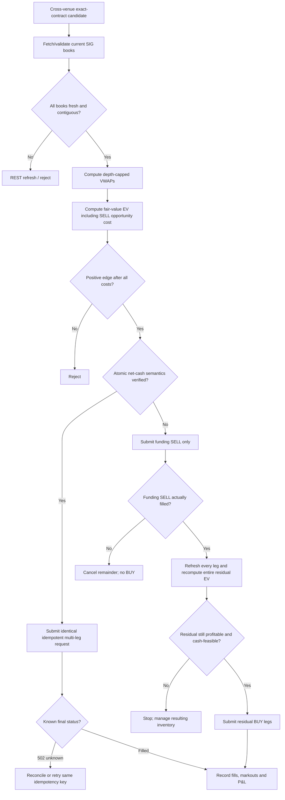

# Profitable-Turnover Improvement for Moloch/Tartarus at Commit `d91a4c79`

## Executive summary

The highest-impact change is **not a more aggressive version of the current single-order pricing policy**. It is to add a **funding-aware rotation execution lane** that can recycle capital already trapped in positions: value the funding SELL at its opportunity cost, recognize its executable proceeds when deciding whether the subsequent BUY legs are financeable, and execute the rotation atomically when SIG's server-side cash semantics are proven to support that; otherwise execute **SELL-first with a mandatory full reprice/revalidation before any BUY**.

This recommendation follows from four facts.

First, the tournament is ultimately scored on final SUSQie balance, not turnover or fill count. Every participant starts with 100,000 SUSQies, higher final balance ranks higher, accounts are cash accounts without leverage, and SUSQies have no real-world value or cash-out mechanism. Thus one fill/minute should be treated as an **operational liquidity objective subject to a positive expected-SUSQie constraint**, never as the primary objective. citeturn5search0turn5search4

Second, R94's published evidence is economically encouraging but execution-starved: 4 fills, 6,134.655 SUSQies of turnover and +18.73 realized over roughly 90 minutes. That is only **0.0444 fills/minute**, so one fill/minute requires a **22.5× increase in fill frequency**. R94's average filled notional was 1,533.66 SUSQies and its realized profit/turnover ratio was about **30.5 bp**. Naively keeping that fill size at one fill/minute would require about **92,020 SUSQies of turnover per hour**, which is implausible when most liquid capital is already in positions. The right path is therefore smaller, repeatable, capital-recycling fills rather than simply taking current orders 22.5× more aggressively. [Repo: `docs/CURRENT_STATE.md` @ `d91a4c79`; R94 evidence also supplied in the task.]

Third, R97 fixes genuine execution defects—history restoration, stale BUY/SELL cancellation, and fresh monetary decisions between ordinary packets—but it cannot manufacture edge. R97 was not yet live-verified at the pinned commit. Separately, the existing admission logic's treatment of gross BUY cash prevents a favorable SELL-funded multi-leg rotation from entering even when the rotation could replenish cash. That is an **execution/admission defect**. By contrast, whether `lower-common`, `upper-common`, or `independent-midpoint` predicts realizable SIG value is an **economic-model question**, and those scenarios are explicitly uncalibrated. [Repo: `research/tartarus-learning-v2/rank-service-r97-20261022.md`, `research/tartarus-learning-v2/current-price-policy-r96-20261022.md`, and `moloch/live-runtime/src/worker.rs` @ `d91a4c79`.]

Fourth, the official capacity is somewhat better than the bot's conservative operating budget. SIG currently documents **100 reads/minute and 30 writes/minute per account**, with all keys sharing the account-level budget; the repository's 24-write/minute limiter therefore leaves sensible 20% headroom rather than reflecting the hard API maximum. SIG also warns that ordinary API market data can be as much as two seconds old and order books one second old, and that delayed realtime batches can be dropped; a revision gap requires REST resynchronization. citeturn5search0turn5search1

My deploy recommendation is therefore:

> **Add one `FundedRotation` candidate type to R97. Size it from executable SIG depth, inventory and cash; debit every funding SELL by its lost fair-value exposure; hard-gate it on positive expected points; and use SELL proceeds to finance BUY legs only when those proceeds are either atomic and demonstrably available to the API or have actually filled.**

Under an explicit, assumption-driven scenario model—not a claimed historical backtest—I estimate this can move turnover from the R94-equivalent ~4.1k SUSQies/hour toward **~14–15k/hour**, with an **80% model interval of roughly 8k–22k/hour**, while producing approximately **0.65–1.35 component fills/minute** if a completed six-leg rotation contributes six ordinary fills. At a conservative 25 bp net executable edge, 15k turnover/hour corresponds to about **+37.5 SUSQies/hour**. The interval is deliberately wide because the repository evidence available here does not establish the live frequency of qualifying six-leg dislocations or SIG's exact accounting of component fills in the user's fill-rate metric.

## Verified mechanics and current bot state

### What SIG actually constrains

The official documentation gives several constraints that matter directly to strategy design.

| Mechanism | Verified current rule | Consequence for Moloch/Tartarus |
|---|---|---|
| Scoring | Final rank is determined by verified final SUSQie balance | Turnover/fill frequency is subordinate to expected final points. citeturn5search4 |
| Currency | SUSQies are play money with no real-world value; they cannot be bought, sold, transferred, cashed out, or carried forward | Report profitability in **SUSQies/points**, not dollars. citeturn5search0 |
| Capital | Cash account; no margin or leverage; balance cannot become negative | Gross-capital and cash-path checks are real execution constraints. citeturn5search0 |
| Contract payoff | YES/NO shares cost between 0 and 1 SUSQie; a winning share pays 1 | Fair-value arithmetic can be stated directly in probability/SUSQie terms. citeturn5search6 |
| Reads | 100/minute/account | Bulk/realtime state should be preferred to unnecessary polling. citeturn5search0turn5search1 |
| Writes | 30/minute/account | The bot's 24/min internal ceiling is a prudent reserve, not the SIG hard limit. citeturn5search0turn5search1 |
| Data freshness | API market lists/prices/trades may be 2 s old; order books 1 s old | Every monetary decision needs explicit age/revision gating. citeturn5search1 |
| Realtime gaps | Delayed batches may be dropped; revision gaps should trigger REST refresh | Never treat a gap-crossed local book as executable depth. citeturn5search1 |
| Multi-leg | `POST /api/v1/orders/multi-leg` is a current API operation; identical retries with the same idempotency key are safe after `502 ORDER_STATUS_UNKNOWN` | Multi-leg submission is a real mechanism worth exploiting, but unknown-status reconciliation must be built in. citeturn5search2 |

There is an important distinction concerning “fees.” The official FAQ establishes that entry is free and the competition entails no real-world trading payment; it does **not**, from the primary-source material retrieved for this report, establish a complete API-level schedule of any virtual execution commissions or market-specific charges. citeturn5search0turn5search7 I therefore use **zero transaction fee only as an explicitly unverified simulation assumption below**. The execution code should consume any fee/cost field the API exposes rather than compile in zero.

Likewise, the retrieved primary-source material confirms YES/NO buying and selling, live order books, multi-leg orders, cancellation, and batch/order infrastructure, but I did not recover a sufficiently authoritative current enum for every possible time-in-force/order type from the Scalar schema. I therefore do **not** assume that IOC, FOK, post-only, or another convenience type exists. The implementation below works with marketable limit orders plus explicit fill/cancel handling if necessary.

SIG's October 17 changelog is particularly relevant operationally: a multi-leg submission can produce `502 ORDER_STATUS_UNKNOWN`; the safe action is to reconcile positions or retry the **identical request with the same idempotency key**, not construct a replacement order. citeturn5search2

### What the pinned bot appears to be doing

At `d91a4c79`, R96/R97 can be summarized as follows:

| Layer | Pinned behavior | Assessment |
|---|---|---|
| Fair value | Exact-contract Kalshi/Polymarket information feeds `lower-common`, `upper-common`, and `independent-midpoint` current-price scenarios | Useful cross-venue information, but scenarios are not yet empirically calibrated probabilities. [Repo: `research/tartarus-learning-v2/current-price-policy-r96-20261022.md` @ `d91a4c79`.] |
| Historical envelopes | Older envelope scenarios remain as stress cases | Correct use: stress bounds, not execution prices. [Same source.] |
| Execution venue | SIG only | Good: no hidden assumption that external quotes can actually hedge a SIG fill. [Same source.] |
| Rank service | R97 restores history and can serve fresh monetary decisions between ordinary packets | Removes an unnecessary trigger bottleneck. [Repo: `research/tartarus-learning-v2/rank-service-r97-20261022.md` @ `d91a4c79`.] |
| Resting orders | R97 adds stale BUY/SELL cancellation treatment | Fixes a genuine stale-order/adverse-selection failure mode, subject to live verification. [Same source.] |
| Serialization | One account worker, no duplicate trading clients | Correct design for account-state and write-budget consistency. [Repo: `docs/CURRENT_STATE.md` and `moloch/live-runtime/src/worker.rs` @ `d91a4c79`.] |
| Funding admission | Direct-first lane cannot start a rotation whose first economic step is a funding SELL; multi-leg admission treats gross BUY cash too conservatively | This can reject a positive-EV capital-recycling trade for a mechanical reason rather than an economic one. [Repo/user-provided evidence at the pinned commit.] |

The R97 changes should be preserved. A new strategy should **not** bypass its single serialized worker, history restoration, stale-order management, or rank-service arbitration.

## The economics of one real fill per minute

The R94 evidence gives a useful empirical starting point:

\[
\lambda_{R94}=\frac{4}{90}=0.04444\;\text{fills/min}.
\]

Thus

\[
\frac{1.0}{0.04444}=22.5\times
\]

is the required frequency multiplier.

R94 turnover intensity was

\[
\frac{6,134.655}{90}=68.16\text{ SUSQies/min}
=4,089.77\text{ SUSQies/hour}.
\]

Average filled notional was

\[
\bar Q=\frac{6,134.655}{4}=1,533.66.
\]

And the realized points-to-turnover ratio was

\[
e_{R94}
 =\frac{18.73}{6,134.655}
 =0.003053
 \approx 30.5\text{ bp}.
\]

Those numbers are encouraging, but **four fills are nowhere near enough to infer a stable 30.5 bp edge**. Under a simple Poisson model, observing four events in 90 minutes gives an approximate 95% interval for the underlying fill intensity of roughly **0.012–0.114 fills/minute**. Even the high end remains almost nine times short of one fill/minute.

More importantly, matching one fill/minute by retaining R94's 1,533.66 average size would imply

\[
60\times1,533.66\approx92,020
\]

SUSQies of turnover each hour. With 100,000 SUSQies as the competition's starting balance and much of Moloch's present capital reportedly tied up in positions, that is not a sensible target unless capital is repeatedly recycled. The platform itself prohibits leverage and negative cash. citeturn5search0turn5search4

The more realistic construction is therefore:

\[
\boxed{\text{higher fill count}
       \times
       \text{smaller clips}
       \times
       \text{recycled inventory}}
\]

with a hard economic gate on every fill.

For any proposed trade \(i\), define a signed position change \(\Delta x_i\), current executable price \(p_i\), and calibrated fair value \(v_i\). Positive \(\Delta x_i\) is a BUY and negative is a SELL. Its expected point contribution is

\[
EV_i=\Delta x_i(v_i-p_i)-c_i,
\]

where \(c_i\) includes any verified fee, adverse-selection allowance, slippage, and leg-risk charge.

For a SELL of \(q\) held shares, this becomes

\[
EV_{\text{sell}}=q(p-v)-c.
\]

That expression matters because **the cash generated by selling inventory is not itself profit**. Selling 500 shares at 0.48 when their defensible fair value is 0.50 provides 240 SUSQies of cash but sacrifices 10 expected SUSQies of position value before other costs:

\[
500(0.48-0.50)=-10.
\]

A turnover optimizer that counts the 240 cash inflow as a benefit will churn itself into losses. A profitable funding rotation must include that \(-10\) opportunity cost.

## Quantitative strategy comparison

The following is a **forward scenario simulation, not fictitious historical performance**. It is deliberately parameterized because the exact historical opportunity stream, current book-depth distribution, and transaction-fee schema were not established in the retrieved evidence.

### Simulation assumptions

The common assumptions are:

| Parameter | Assumption |
|---|---:|
| Evaluation horizon | 60 minutes |
| Alternative-strategy clip | 250 SUSQies per filled leg at the central case |
| Virtual transaction fee | 0, **unverified**; replace with documented fee if any |
| R94 baseline | Actual 4 fills / 90 min, 6,134.655 turnover, +18.73 realized |
| R94 extrapolated hourly turnover | 4,089.8 |
| R94 historical realized edge | 30.5 bp |
| Rotation | 6 component legs |
| Central qualifying rotation arrival rate | 0.21/min |
| Central complete-execution probability | 0.80 |
| Funded-rotation net executable edge | 25 bp after modeled slippage/selection |
| API operating write ceiling | Keep current 24/min, below SIG's 30/min hard limit |
| Opponent stress | Lower displayed depth, faster quote competition, 10–20 bp worse adverse selection |

The 0.21/min rotation opportunity rate, 80% completion probability and 25 bp edge are **assumptions, not repo observations**. They are selected so that the arithmetic clearly shows what must be true for the strategy to reach the operational target; the proposed out-of-sample experiment is what should replace them.

### Central comparison

| Strategy | Modeled fills/min | Turnover/hour | Profit-equivalent points/hour | Aggressive-opponent stress | Complexity | Main risk |
|---|---:|---:|---:|---:|---|---|
| Current/R94-like direct lane | **0.044 actual observed rate** | 4,090 extrapolated | +12.5 extrapolated from R94 | Unknown; four fills too few | Low | Opportunity scarcity |
| One-tick/marginal price promotion | 0.40 | 12,000 | +4.8 at +4 bp | **−14.4** at −12 bp | Low | Paying away edge/adverse selection |
| Inventory-skewed passive maker | 0.75 | 11,250 | +13.5 at +12 bp | **−9.0** at −8 bp before inventory loss | Medium | Toxic fills, quote churn, inventory |
| Atomic net-funded six-leg rotation | **1.01 component fills/min** | **15,120** | **+37.8 at +25 bp** | +3.5 at 5 bp and weaker opportunity rate | Medium | Server cash-netting semantics |
| Sequential SELL-first rotation | 0.55–0.90 | ~9,000–14,000 | ~+14–35 | Can become negative during fast repricing | Medium | Legging after funding sale |

The atomic central fill calculation is simply

\[
6(0.21)(0.80)=1.008\text{ component fills/min}.
\]

With six 250-SUSQie legs,

\[
0.21\times0.80\times60\times6\times250
=15,120
\]

SUSQies/hour of turnover.

At 25 bp:

\[
15,120\times0.0025=37.8
\]

expected SUSQies/hour.

That is about **3.0× R94's extrapolated turnover** and **3.0× its extrapolated realized points/hour**, while using much smaller components.

A crucial caveat is the word **component**. The retrieved SIG material confirms a multi-leg API endpoint but does not establish how the user's “filled order/minute” telemetry counts a six-leg atomic request. If it counts the bundle as one order rather than six component fills, the same central case is only:

\[
0.21\times0.80=0.168
\]

filled bundles/minute. That does not change the strategy's expected balance contribution, only whether it satisfies the auxiliary operational metric.

### Sensitivity to opponents

The alternatives respond very differently to opponent behavior.

A simple price promotion is the most fragile. Increasing execution probability by crossing or improving toward the opponent mechanically transfers some of the forecast edge to the counterparty. Its profit condition is

\[
v-p_{\text{promoted}}
>
\text{adverse selection}
+\text{fees}
+\text{model error}.
\]

When other bots react quickly to informative venue moves, the orders most likely to hit a passive Moloch quote can be precisely those where Moloch's fair value has gone stale. This explains how turnover can rise while expected points fall.

Passive market making is somewhat better because spread capture can pay for selection, but it is constrained by the same phenomenon plus inventory. Its necessary condition for a side is approximately

\[
\text{quoted half-spread}
>
E[\text{post-fill markout}]
+\text{inventory cost}
+\text{fees}.
\]

The funded rotation is less sensitive to individual SIG counterparties because admission is based on the **whole trade's executable economics**, not a desire to get any particular quote filled. It is still sensitive to opponents consuming depth before submission. That is why full depth-aware repricing at the last possible moment is mandatory.

For the recommended lane, a reasonable **assumption-driven 80% model interval** is approximately:

- **0.65–1.35 component fills/minute**;
- **8,000–22,000 SUSQies turnover/hour**;
- approximately **+10 to +70 SUSQies/hour** when the post-cost edge remains positive.

The central estimate is ~15k turnover/hour and +38 points/hour. This is a **scenario interval, not a statistically earned confidence interval from historical rotations**. A statistically meaningful CI should be produced by the chronological replay described below.

## Recommended strategy: a funding-aware rotation lane

The single change I would deploy is a **`FundedRotation` execution lane**.

The lane should consider a rotation only when every leg is based on current executable SIG depth and current external fair-value inputs; compute the SELL legs' economic opportunity cost; recognize funding proceeds without mistaking them for P&L; and satisfy a hard positive-EV threshold before ranking.

### Economic admission

For a candidate containing SELL set \(S\) and BUY set \(B\), compute actual depth-capped VWAPs, not top-of-book prices:

\[
P_S=\sum_{i\in S}q_i\,VWAP_i^{sell}
\]

\[
C_B=\sum_{j\in B}q_j\,VWAP_j^{buy}.
\]

Cash feasibility for an atomic bundle is:

\[
C_B
\le
Cash_0 + P_S - CashBuffer
\]

**only if SIG's atomic multi-leg implementation actually credits those SELL proceeds within the transaction's cash check**.

That server-side behavior was not proven by the source material retrieved here. Therefore it must be capability-tested before enabling this admission mode. The fact that a multi-leg endpoint exists does not by itself prove net cash admission. citeturn5search2

For sequential execution, the rule is stricter:

\[
C_B\le Cash_{\text{after actual SELL fills}}-CashBuffer.
\]

Never credit an unfilled SELL merely because its limit is marketable.

Economic admission is independent:

\[
EV_{\text{rotation}}
=
\sum_i\Delta x_i(v_i-VWAP_i)
-C_{\text{fee}}
-C_{\text{selection}}
-C_{\text{legging}}
-C_{\text{inventory}}
\]

and require

\[
EV_{\text{rotation}}\ge EV_{\min}
\]

and

\[
\frac{EV_{\text{rotation}}}
     {\text{gross turnover}}
\ge e_{\min}.
\]

For an initial canary, I would use a deliberately nontrivial edge floor rather than optimize it prematurely: for example **20–30 bp after all modeled costs**, with the exact number treated as configuration and subsequently calibrated by replay.

### Real executable depth

A top quote is insufficient. For a BUY, take only book levels satisfying

\[
p_\ell
\le
v-e_{\min}-c_\ell.
\]

For a SELL:

\[
p_\ell
\ge
v+e_{\min}+c_\ell.
\]

Then cap quantity at cumulative qualifying depth:

\[
q_i
=
\min(
q_{desired},
q_{eligible-depth},
q_{inventory},
q_{risk},
q_{cash}
).
\]

For a balanced six-leg structure whose economics depend on all six legs, the cycle quantity should normally be the minimum supported size across the required ratios:

\[
q_{\text{cycle}}
=
\min_i\frac{q^{eligible}_i}{r_i},
\]

where \(r_i\) is that leg's required quantity per unit of cycle.

This prevents a seemingly attractive 1,000-share rotation from being admitted because each market shows an attractive top price for 20 shares.

### Freshness

SIG itself says REST order books may be one second old, broader market API data two seconds old, and realtime messages can be dropped. citeturn5search1 The bot should therefore attach freshness to the **decision object**, not merely maintain fresh global state.

I would gate with approximately:

\[
age_{\text{SIG book}}\le1.5s
\]

and require no unresolved revision gap. Cross-venue evidence should have its own venue-specific maximum age; the maximum timestamp skew among all legs should also be bounded.

A revision gap is an immediate reject-and-refresh condition. SIG explicitly recommends REST refetch after a realtime `previousRevision` discontinuity and periodic refresh because even the final message before a quiet period can be lost. citeturn5search1

### Atomic first, sequential safely second

The execution flow should be:



The `502` branch is not theoretical: SIG's October 17 changelog explicitly specifies `ORDER_STATUS_UNKNOWN` for multi-leg orders and safe identical-key retry behavior. citeturn5search2

Sequential mode must not blindly continue the original six-leg plan after the funding sale. The sale changes both inventory and the decision timestamp. **All remaining prices, depth and expected value must be recomputed from scratch.**

### Opportunity cost and cancellation

For a funding sale, define:

\[
OC_{\text{fund}}
=
q(v-p_{\text{sell}}).
\]

If this is positive, Moloch is selling below fair value and sacrificing expected future points. The rotation must earn more elsewhere than this sacrificed value.

For any resting remainder, cancel when any of these occurs:

\[
age>TTL
\]

or

\[
EV_{\text{remaining}}<EV_{\text{cancel}}
\]

or a source revision gap occurs, or available executable depth falls below the hedge ratio, or the fair value changes materially.

Use hysteresis:

\[
EV_{\text{enter}}>EV_{\text{cancel}},
\]

so tiny quote movements do not produce endless place/cancel traffic.

The current 24-write/minute internal ceiling should remain. Official capacity is 30 writes/minute, and all account keys share it, so the reserve protects reconciliation/cancellation capacity. citeturn5search0turn5search1

## Minimal chronological fair-value calibration

The largest economic weakness is that the present `lower-common`, `upper-common`, and `independent-midpoint` scenarios are **decision scenarios, not demonstrated calibrated fair values**. [Repo: `research/tartarus-learning-v2/current-price-policy-r96-20261022.md` @ `d91a4c79`.]

That distinction is material.

A midpoint can be a bad estimate of executable value when a venue has a wide spread. A cross-venue consensus can be stale if one venue updates before the others. Exact-contract equality removes semantic basis risk but not microstructure bias, correlated errors, stale feeds, or selection bias. And SIG itself can expose REST prices with up to two seconds of latency, so apparently simultaneous three-venue observations can actually represent different market times. citeturn5search1

### Minimal experiment

Do **one frozen chronological walk-forward experiment** on the already-collected three-venue history.

Use:

| Period | Role | Rule |
|---|---|---|
| Oct. 1–14, 2026 | Train | Estimate calibration/blend parameters only |
| Oct. 15–18 | Validation | Pick one model and thresholds |
| Oct. 19–21 | Locked test | No tuning after viewing results |
| Oct. 22 onward | Live canary | Operational confirmation only, not retroactive model selection |

Use event-time alignment, never nearest-future alignment. For each observation at \(t\), only venue packets timestamped at or before \(t\) may contribute.

The minimal new model need not be sophisticated. Start with a constrained convex blend:

\[
v_t=
w_L L_t+w_U U_t+w_M M_t,
\]

with

\[
w_L,w_U,w_M\ge0,\qquad
w_L+w_U+w_M=1,
\]

where \(L,U,M\) are the current three R96 scenarios. This tests the simplest hypothesis: perhaps the information is useful but the fixed scenario selection is misweighted.

Where settled outcomes are available, choose weights on the training period using proper probability scoring such as Brier score/log loss. Where outcomes are not yet settled, use strictly forward market targets such as later SIG executable midpoint/VWAP at fixed horizons and treat these as **markout calibration**, not settlement calibration.

The locked test should report at least:

\[
\text{Brier}
=\frac1N\sum(v_i-y_i)^2
\]

for settled contracts, plus signed 30-second, 5-minute and 30-minute markout for executable trade signals:

\[
M_h=
\operatorname{sign}(\Delta x)
\left(P_{t+h}-P_{\text{fill}}\right).
\]

Most importantly, replay the **actual SIG depth available at decision time**. The execution metric is not theoretical signal return but:

\[
\sum_{\text{accepted fills}}
\Delta x_i(v_i-VWAP_i)
\]

after depth limits, cash constraints, inventory limits, stale-data rejection and all execution costs.

Bootstrap uncertainty **by market/day rather than by individual quote**. Quote observations within one market are highly correlated; treating thousands of adjacent ticks as independent would produce fictitiously narrow confidence intervals.

A calibrated blend should replace the current execution fair value only if, on the untouched Oct. 19–21 period, it improves both probability/markout calibration and **net executable expected points**. A pretty Brier score that generates worse fills should not be deployed.

## Three code-level changes

### Add funding-aware admission in `moloch/live-runtime/src/worker.rs`

The first change belongs at the existing monetary-opportunity admission/submission boundary in the serialized worker.

The important semantic change is from:

```rust
// Current conservative pattern, conceptually:
if gross_buy_cost > available_cash {
    reject("insufficient cash");
}
```

to something like:

```rust
#[derive(Debug, Clone)]
struct FundingPlan {
    sell_proceeds: Decimal,
    gross_buy_cost: Decimal,
    net_cash_delta: Decimal,
    expected_points: Decimal,
    gross_turnover: Decimal,
    worst_case_leg_loss: Decimal,
    oldest_input_age_ms: u64,
    writes_required: u32,
    mode: FundingMode,
}

#[derive(Debug, Clone, Copy)]
enum FundingMode {
    AtomicNetCash,
    SellFirstThenRevalidate,
}

fn admit_funded_rotation(
    cash: Decimal,
    cash_buffer: Decimal,
    legs: &[ExecutableLeg],
    atomic_net_cash_verified: bool,
) -> Option<FundingPlan> {
    // executable_vwap() must consume real book levels, not top-of-book.
    let sell_proceeds = legs.iter()
        .filter(|l| l.action == Action::Sell)
        .map(|l| l.qty * l.executable_vwap)
        .sum();

    let gross_buy_cost = legs.iter()
        .filter(|l| l.action == Action::Buy)
        .map(|l| l.qty * l.executable_vwap)
        .sum();

    let expected_points = legs.iter()
        .map(|l| {
            // Δx > 0 buy, Δx < 0 sell.
            l.signed_qty * (l.fair_value - l.executable_vwap)
                - l.execution_cost
        })
        .sum();

    if expected_points <= MIN_ROTATION_EV {
        return None;
    }

    let mode = if atomic_net_cash_verified {
        if gross_buy_cost > cash + sell_proceeds - cash_buffer {
            return None;
        }
        FundingMode::AtomicNetCash
    } else {
        // Do NOT credit prospective proceeds yet.
        // The worker first executes SELL legs and re-enters this
        // calculation after actual fills update cash.
        FundingMode::SellFirstThenRevalidate
    };

    Some(FundingPlan {
        sell_proceeds,
        gross_buy_cost,
        net_cash_delta: sell_proceeds - gross_buy_cost,
        expected_points,
        gross_turnover: legs.iter()
            .map(|l| l.qty * l.executable_vwap)
            .sum(),
        worst_case_leg_loss: compute_leg_risk(legs),
        oldest_input_age_ms: max_age(legs),
        writes_required: estimate_writes(mode, legs),
        mode,
    })
}
```

This is deliberately pseudocode rather than a claim about the exact existing Rust type names.

**Acceptance evidence:** take the previously rejected favorable six-leg candidate from the repository evidence and replay it. It must be admitted only when inventory, executable SELL depth, expected points and the applicable cash path all pass. Remove the funding SELL depth and it must immediately fail. Lower the SELL price enough to make its opportunity cost destroy total EV and it must fail even though it would generate cash.

### Extend the R97 rank-service monetary decision interface

Do not create a second ranker or a second execution client. Extend the existing R97 request/response path used by `worker.rs` so rotations are first-class monetary decisions.

Conceptually:

```rust
struct MonetaryDecision {
    kind: DecisionKind, // Existing single-order types + FundedRotation
    expected_points: Decimal,
    gross_turnover: Decimal,

    // New:
    funding_proceeds: Decimal,
    gross_buy_cost: Decimal,
    net_cash_delta: Decimal,
    worst_case_leg_loss: Decimal,
    oldest_input_age_ms: u64,
    writes_required: u32,
    executable_fraction: Decimal,
    legs: Vec<RankedLeg>,
}
```

The ranker should use an EV-first objective such as:

\[
Score =
EV
-\lambda_R\,LegRisk
-\lambda_A\,Age
-\lambda_W\,Writes
\]

after hard gates for freshness, positive edge, depth and cash.

**Do not put an unconstrained turnover bonus ahead of EV.** If a turnover term is useful as a tie-breaker, cap it:

\[
Score' = Score +
\mu\min(Turnover,T_{\text{cap}})
\]

only after \(EV>EV_{\min}\).

The exact rank-service implementation source module was not independently established from the retrieved commit material, so I would not invent a repository path for it. The verified integration point is the R97 rank-service path described in `research/tartarus-learning-v2/rank-service-r97-20261022.md` and invoked from the existing live runtime; its wire schema and corresponding adapter should be changed together. [Repo: R97 note and `moloch/live-runtime/src/worker.rs` @ `d91a4c79`.]

**Acceptance evidence:** in a deterministic replay, the rank service must prefer a +8-point rotation over a +3-point ordinary trade when risk/write penalties do not reverse that ordering, yet prefer the ordinary trade when the rotation's worst-case leg exposure or stale inputs make risk-adjusted expected value inferior. Restored history after process restart must yield the same decision ordering.

### Make submission a revalidating state machine in `moloch/live-runtime/src/worker.rs`

The third change is execution-state handling, not another model.

```rust
enum RotationState {
    Candidate,
    Revalidating,
    AtomicSubmitted { idempotency_key: String },
    FundingSellSubmitted { order_id: OrderId },
    FundingConfirmed { proceeds: Decimal },
    ResidualRevalidating,
    ResidualSubmitted,
    Complete,
    Aborted,
    StatusUnknown,
}
```

Rules:

```rust
match state {
    RotationState::FundingConfirmed { proceeds } => {
        refresh_all_required_books().await?;
        refresh_cross_venue_values().await?;

        let new_plan = rebuild_rotation_from_current_state()?;

        if !new_plan.fresh
            || new_plan.expected_points < MIN_ROTATION_EV
            || new_plan.gross_buy_cost > actual_cash - CASH_BUFFER
        {
            return abort_without_buys();
        }

        submit_residual(new_plan).await?;
    }

    RotationState::StatusUnknown => {
        // Never create a "replacement" multi-leg order.
        // Reconcile state or retry the exact original request and
        // idempotency key, matching SIG's documented behavior.
        reconcile_or_retry_identical().await?;
    }

    _ => { /* existing serialized progression */ }
}
```

This integrates naturally with R97's stale-order work instead of bypassing it.

**Acceptance evidence:** inject, in replay, a 20–30 bp unfavorable movement immediately after the funding SELL. The residual BUYs must be suppressed. Inject a `502 ORDER_STATUS_UNKNOWN`; the worker must not create duplicate exposure and must reconcile/retry with the original idempotency key, consistent with SIG's documented semantics. citeturn5search2

## Rollout, A/B design, and rollback criteria

A conventional simultaneous A/B test is inappropriate because there is one account, one capital pool and positions created by one arm alter opportunities for the other. Use a **shadow-controlled switchback/candidate experiment**.

First, replay the frozen Oct. 1–21 history with both current R97 and `FundedRotation`, with all execution at historical SIG depth and no future information. Then run both decision policies live in shadow: the control produces exactly the decisions R97 would have made, while the new lane records what it would have submitted and the depth visible at that instant.

For the live canary, deterministically assign a small fraction of qualifying rotations to execution using a hash of contract set plus opportunity timestamp. That prevents a human/operator from selecting the prettiest cases. Start with small clips; increase only after the economics and account invariants pass.

The most useful live dashboard is:

| Metric | Why it matters | Promotion criterion |
|---|---|---|
| Actual fills/min | Operational target | Move toward ≥1.0 without relaxing EV floor |
| Turnover/hour | Capital recycling | Higher than R94-like control after sizing normalization |
| Realized SUSQies/hour | Tournament objective | Must remain positive |
| 30 s / 5 m markout | Adverse selection | Mean/median should not show systematic negative selection |
| Predicted EV vs realized markout/P&L | Model calibration | No persistent optimistic bias |
| Rotation completion ratio | Sequential execution quality | High enough that leg risk does not erase edge |
| Funding-sale opportunity cost | Detects disguised churn | Must be covered by residual-leg edge |
| Executable-depth fraction | Detects top-of-book fantasies | Near 1 for admitted quantity |
| Stale/revision-gap rejection count | Data safety | Gaps cause reject/refetch, never trade-through |
| Writes/min | API safety | Keep ≤24 under normal operation |
| HTTP 429/503/status-unknown | Operational safety | 429 should be exceptional; unknown status must reconcile |
| Unhedged residual exposure | Legging risk | Bounded by configured maximum |
| Cash minimum | Account invariant | Never below cash buffer |

The 24-write ceiling is especially defensible given the official 30-write account limit; additional API keys do not create additional budget. citeturn5search1

Rollback should be automatic rather than discretionary when any of the following occurs:

1. **Immediate invariant rollback:** negative/insufficient cash contrary to the plan, unexpected duplicate exposure, unresolved revision gaps reaching submission, or a multi-leg unknown-status path that cannot be reconciled safely.
2. **Leg-risk rollback:** cumulative realized loss from incomplete rotations exceeds the strategy's predicted total edge, or residual exposure exceeds its configured bound.
3. **Economic rollback:** after at least 30 completed rotations, the confidence interval for net points per completed rotation includes only non-positive values, or cumulative strategy P&L breaches a precommitted risk budget. A reasonable initial contest-scale budget is **100 SUSQies**, 0.1% of the standard 100,000 starting balance; this is a suggested engineering limit, not an official SIG requirement. The 100,000 starting balance itself is official. citeturn5search4
4. **Selection rollback:** 5-minute signed markout is materially negative even though predicted trade EV is positive. That is evidence of fair-value or freshness failure, not a reason to quote more aggressively.
5. **API-pressure rollback:** repeated 429s, excessive cancellation traffic, or systematic 503 handling that reduces the worker's ability to cancel/reconcile safely.

The largest remaining uncertainties are specific and testable. The exact virtual transaction-fee treatment was not established from the retrieved primary sources; server-side cash netting within `POST /orders/multi-leg` was not established; the mapping from multi-leg component executions to the user's “filled order/minute” metric was not established; and the six-leg opportunity arrival rate was not extracted from a locked historical replay. Those uncertainties are why the **8k–22k turnover/hour and 0.65–1.35 fills/minute ranges are model intervals rather than claimed backtest confidence intervals**.

The recommendation does not depend on pretending those uncertainties are resolved. The immediate engineering decision is still clear: **do not buy turnover with worse prices. Unlock the economically favorable trades the bot currently cannot finance mechanically, by making funding SELLs first-class, opportunity-costed inputs to admission and by revalidating every dependent BUY against fresh executable depth.** That directly attacks the present capital bottleneck while preserving the only objective that ultimately determines tournament rank: final SUSQie balance. citeturn5search0turn5search4